# 引言

MIPI I3C接口的开发旨在通过提供一种快速、低成本、低功耗的双线数字接口，以简化移动无线产品中传感器系统设计架构。

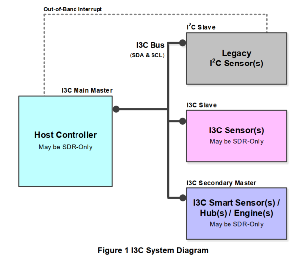

## 关键特性

- 使用push-pull的双线串行接口，最高支持12.5MHz
- 传统I2C设备在同一总线上的共存（存在一些限制）
- 动态寻址，同时支持传统I2C设备的静态寻址
- 传统I2C的消息
- 类似I2C的单数据速率消息（SDR）
- 可选的高数据速率消息模式（HDR）
- multi-drop
- multi-master
- 带内中断支持
- hot-join支持
- 同步时序支持和异步时间戳

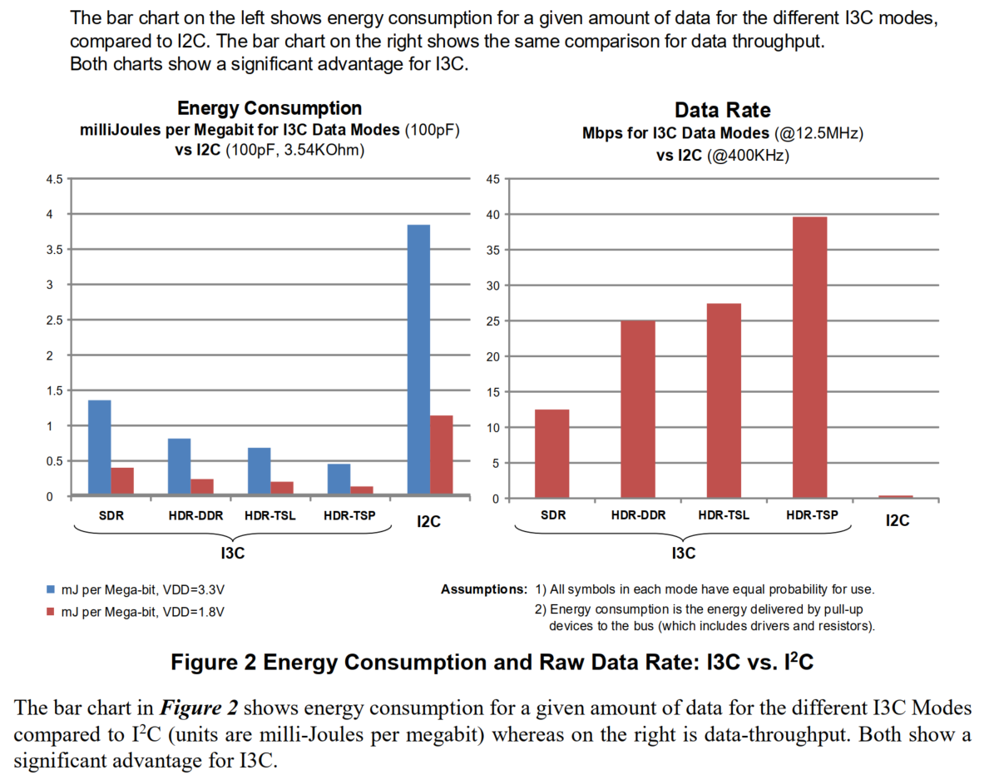

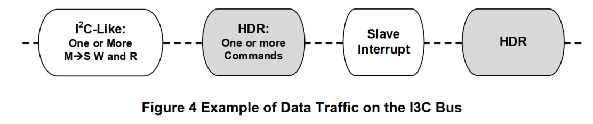

## 如何启动I3C

- 所有I3C通信发生在一个帧内，帧以开始（START）指令开始，之后是一个或多个传输，最后以停止STOP指令结束

- 对于HDR模式

  - 首先，专用广播I3C地址7'h7E发送到I3C总线上的所有target

  - 然后是一个entry HDR CCC发送，指示控制器正在进入HDR模式。每个HDR模式都有属于自己的entry HDR CCC

  - 之后是一个或多个HDR传输

  - HDR模式使用HDR退出协议结束

    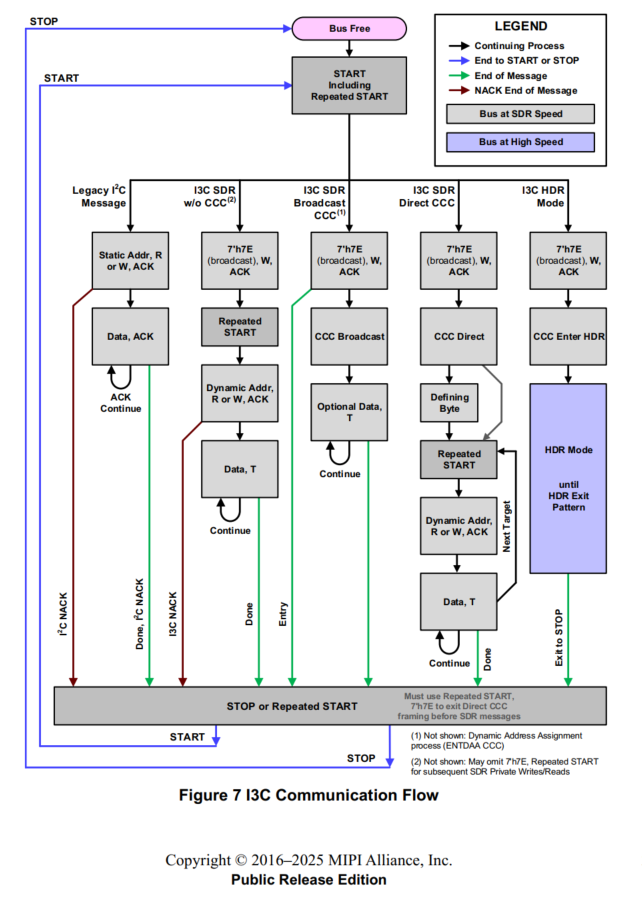

1. I3C基于帧封装方式，一个帧包含一个数据payload，使用SDR或者HDR的传输协议
2. I3C帧至少包含START、header、Data和STOP，帧的边界由I2C类总线管理
3. header用于总线仲裁，控制器使用header来寻址target设备。用于：带内中断，hot-join和第二控制器功能
4. ENTHDRx common command codes(CCCs)用于进入HDR模式
5. 在任何时刻，I3C仅允许一个控制器控制I3C总线，提供了控制器角色从一个设备转移到另一个设备的机制

# I3C控制器和目标设备

### I3C控制器设备

1. 为了确保该I3C总线正常工作，总线上的多个I3C设备只能有一个最初被配置（初始化）为I3C控制器设备。该I3C设备将具有“主控制器”设备角色，并将成为总线上第一个作为活动控制器的I3C设备；所有其他I3C设备和I2C设备将在I3C总线上最初被配置为目标设备

2. I3CF引入了活动控制器的概念（active controller）,定义为在I3C总线上当前正在充当控制器的I3C控制器设备（即，正在控制总线的设备）。在I3C总线上，仅有一个设备可以同时担任活动控制器。然而，在初始总线配置完成后，活动控制器的功能可以通过提供的I3C命令（CCCs）以协作方式从活动控制器传递到总线上任何其他具有I3C控制器设备能力的设备。

3. 每个I3C设备通过BCR（bus characteristics register）暴露其支持的设备角色

   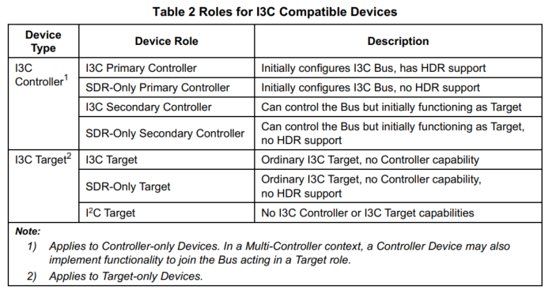

4. 除了发送I3C命令和I2C消息外，I3C控制器设备还：

   - 在SDR mode、HDR mode和HDR-BT mode下产生总线时钟
     - I3C target设备在读传输时产生总线时钟是可选的
     - 在HDR Ternary模式中没有传统的时钟（不包含在I3C basic中）
   - 管理pull-up结构
   - 在充当活动控制器时管理动态地址分配
     - 基于SETDASA,SETAASA或者ENTDAA方法（包含hot-join事件）
   - 管理来自I3C目标设备在总线上的START请求以及地址仲裁
     - 带内中断
     - hot-join
     - 成为active controller
   - 支持I2C target设备
   - 支持I3C SDR模式

   此外，I3C控制器设备可以可选支持I3C定义的HDR模式的任意组合

   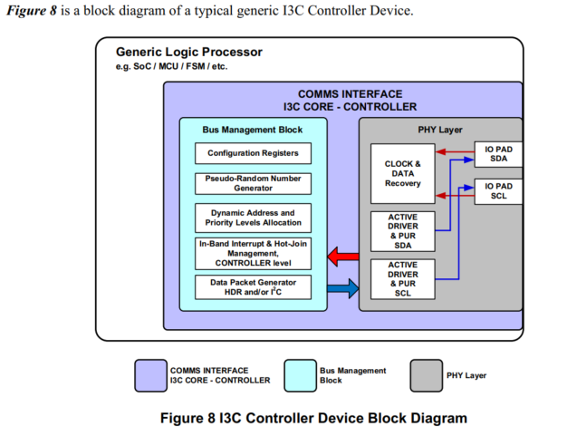

5. I3C控制器设备角色

   所有I3C控制器设备支持两种primary controller device角色之一，或者支持两种secondary controller device角色

   **primary controller device roles**

   - primary controller:在I3C总线上的I3C控制器设备初始化配置I3C总线并且作为第一个active controller。在给定的I3C总线上仅能有一个I3C设备成为primary controller，即此责任不能转移给I3C总线上的其他任何I3C设备。支持SDR模式和至少一种HDR模式
   - SDR-only primary controller：仅支持I3C的SDR mode的一个primary controller，即不支持任何HDR模式

   **secondary controller device roles**

   - I3C secondary controller: 在I3C总线上，除活动控制器外的任何具有I3C控制器能力的I3C设备。一个I3C总线上可以有多个secondary controller同时存在。根据定义，次级控制器作为I3C目标设备功能，除非它成为活动控制器。支持SDR模式和至少一种HDR模式
   - SDR-only secondary controller:仅支持I3C的SDR模式的次级控制器，即不支持任何HDD模式

   > [!IMPORTANT]
   >
   > 活动控制器并未正式定义为I3C设备角色，并且未在I3C设备的总线特性寄存器BCR中暴露

### I3C目标设备

1. I3C目标设备监听I3C总线，接收由活动控制器发送的相关I3C命令，并根据需要做出响应。这包括所有广播命令以及特定针对该I3C目标设备并得到其支持的任何定向命令

2. 除了响应I3C命令外，I3C慕白哦设备始终支持I3C SDR模式

3. I3C目标设备不生成总线时钟，并始终遵循活动控制器生成的总线时钟，除非在：

   - 在HDR-BT模式下进行读取传输（可选，由实施者自行决定）。在地址分配方面，I3C目标设备至少支持一种动态地址分配方法
   - 此外，I3C target设备是可选的：
     - 带内中断
     - 产生hot-join事件
     - 请求成为active controller（如果target 设备是一个secondary controller）
     - 支持I3C定义的HDR模式的任意组合

   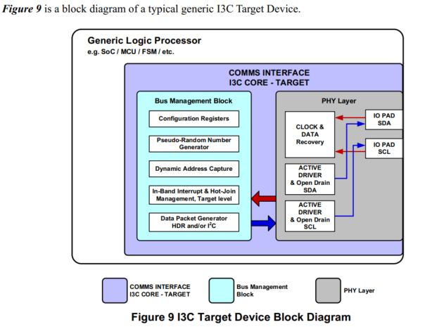

4. 所有的I3C目标设备支持I3C目标设备角色中的一种：

   **I3C target**:一种普通的I3C目标设备，未具备控制器能力。支持SDR模式和至少一种HDR模式

   **SDR-only I3C target**:一种不具备控制器能力的I3C目标，仅支持I3C的SDR模式（即，不支持任何HDR模式）

# 必须元素

## 概述

1. SDR模式是I3C总线的默认模式，SDR模式用于进入其他模式、子模式和状态；以及内置功能，例如CCCs、IBIs以及从I2C到I3C通过分配一个动态的方式进行过渡
2. I3C SDR模式在程序和条件方面与I2C协议非常相似。因此，I3C设备和许多I2C目标设备（不包含I2C控制器设备）可以共存于同一I3C基本总线。I3C协议设计为I2C流量被所有I3C目标正确忽略。I3C控制器到I3C目标的流量将不会被大多数I2C目标设备看到。因为I2C尖峰过滤器对I3C的更高时钟速度是不可见的。
3. HDR模式是一个可选模式，允许数据速率高于SDR模式。虽然HDR模式的使用是可选的，但所有I3C设备都必须处理进入和退出这些模式，此要求使得支持HDR的设备与SDR设备能够在同一总线上工作。在进入HDR模式之后，仅支持SDR模式的设备将忽略所有消息（HDR模式消息），直到HDR退出完成，并且总线返回到SDR模式。、

## 总线配置

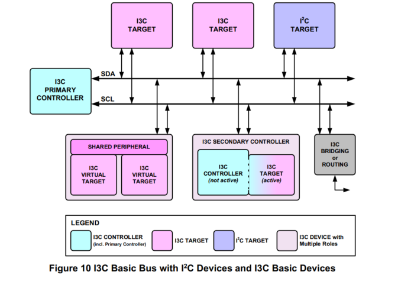

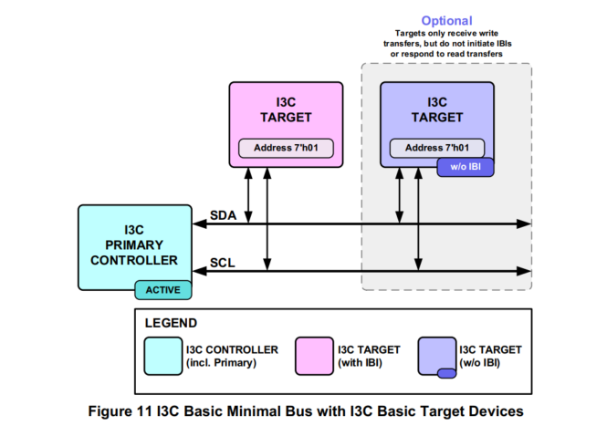

1. 兼容I3C-basic的设备可具备多样的功能特性，适配其在I3C-basic总线内承担的功能。

- 在具体的实例中，一台设备的全部特性并非都需要开启；但所有已启用的功能特性，都必须存放于该设备及其工作角色对应的特性寄存器中
- I3C-basic主控制器需要在上电阶段获取总线上所有传统I2C从机的设备参数（例如挂在在总线之上每一台I2C设备的固定地址）
- 每次从断电状态上电启动时，主控制器需要为总线内所有处于激活工作状态的设备（包含自身）分配唯一动态地址。
- 动态地址决定了带内中断的优先级排序。总线上面所有次控制器，需要依靠公共命令码CCC获知每一台I3C-basic兼容设备的动态地址以及特性寄存器信息

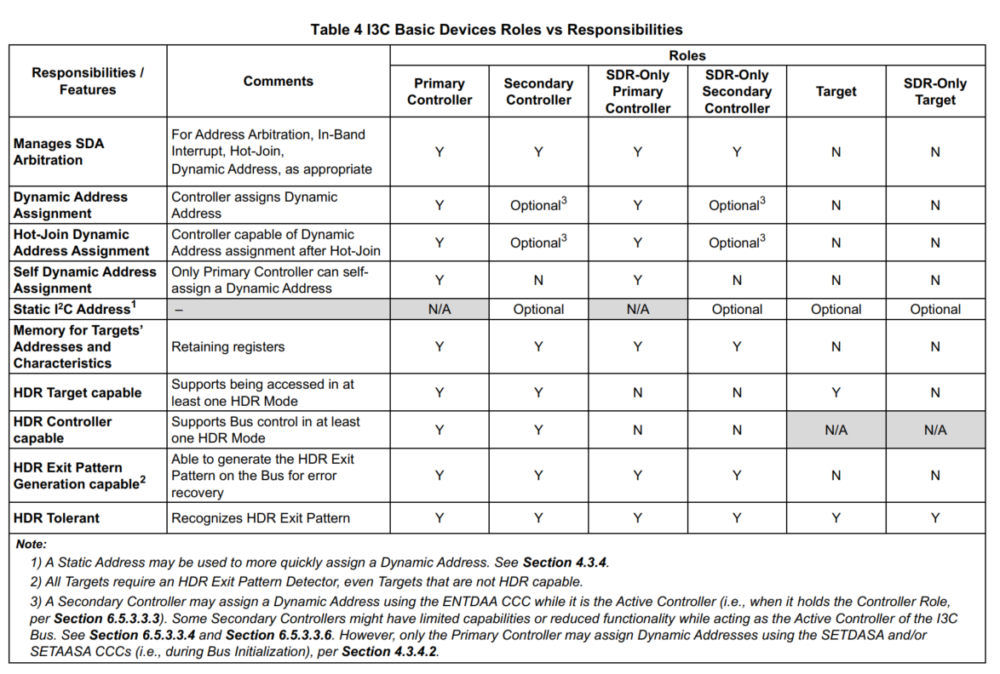

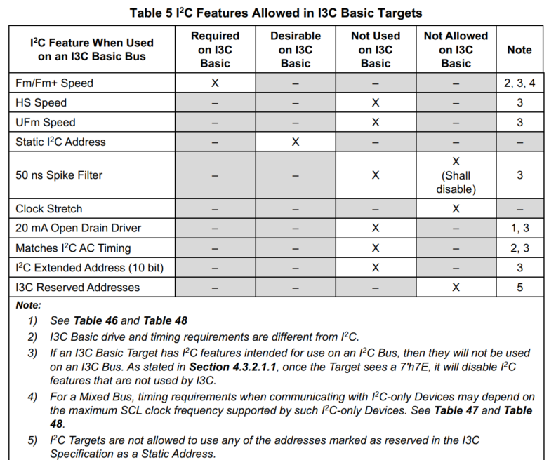

## 特性寄存器

- bus characteristics register(BCR)
- device characteristics register(DCR)
- Legacy virtual register(LVR)

每个与I3C兼容的设备应根据设备类型关联特性寄存器：

- 仅承担一个激活角色的I3C设备，拥有一个总线特性寄存器与1个设备特性寄存器；两组寄存器绑定该设备的动态地址
- 具备多个激活角色的I3C设备有两种方案：可以共用一套总线特性寄存器+设备特性寄存器，作用于全部激活角色；也可以为每一个激活角色配置独立的寄存器组，各组绑定对应角色的动态地址
- 可对外提供多个虚拟从机节点的复合型I3C设备，一般需要配置相互独立的总线、设备特性寄存器；也就是每一个虚拟从机分配一组寄存器，并绑定自身动态地址
- 所有接入I3C总线的传统I2C外设，都配有对应的传统虚拟寄存器。由于属于旧式I2C设备，该寄存器为软件虚拟实现，常见实现方式存放于设备驱动内部。

### BCR

所有挂载至 I3C‑Basic 总线的 I3C‑Basic 设备，都必须配有只读型**总线特性寄存器（BCR，Bus Characteristics Register）**。

该只读寄存器用于描述这台 I3C‑Basic 合规设备的总线角色与硬件能力，服务于动态地址分配以及公共命令码（CCC）交互流程。BCR 内部各个比特位需要严格遵循表 7 给出的位定义：

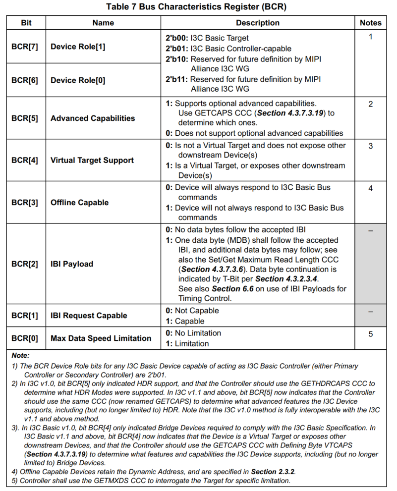

### DCR

每一台接入 I3C‑Basic 总线的设备，都必须配备只读的**设备特性寄存器（DCR，Device Characteristics Register）**。

该只读寄存器用于标识 I3C‑Basic 合规设备的器件类型（例如加速度计、陀螺仪等），供动态地址分配、公共命令码交互流程使用。DCR 的各位定义必须严格遵守表‑8 的规范

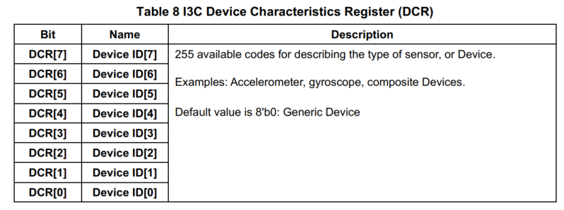

### LVR

所有可挂载至 I3C‑Basic 总线的传统 I2C 设备，都必须配有只读**传统虚拟寄存器（LVR，Legacy Virtual Register）**，用来描述设备的关键功能属性。

由于它们属于旧式 I2C 设备，该寄存器为软件虚拟实现，典型存放位置为设备驱动程序内部。

当 I3C‑Basic 总线上挂载有传统 I2C 设备时，LVR 参数决定 I2C‑从机允许的工作模式以及 SCL 时钟最高频率。LVR 的各个比特位需要严格遵循表 9 的位定义。

全部 LVR 参数由管控 I3C‑Basic 总线的上层单元进行配置生成，并在总线初始化配置之前下发给 I3C‑Basic 主控制器。主控制器始终保存所有 I2C 外设的 LVR 信息。

主控制器需要通过 DEFTGTS 公共命令码（CCC），将全部 I2C 设备的 LVR 数据发送至各个副控制器

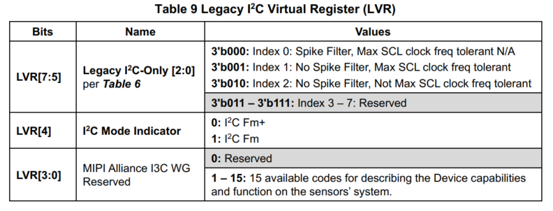

## 总线通信

I3C-basic的主要协议和模式是SDR模式。SDR协议基于I2C标准协议，并具有一些显著的变化：

- I3C基础的START和STOP条件，在信号传递上与I2C相同，但它们的时序可能不同

  > [!NOTE]
  >
  > 在I3C SDR（而不是HDR）中，停止或重复开始在SCL为高且控制器控制SDA或SDA为开漏的任何时刻均被允许（即，可能出现）。这与I2C不同，后者仅在地址的NACK之后或数据的ACK/NACK之后要求停止或重复开始。虽然I3C基本SDR也倾向于只在这些情况下使用，并且在I3C广播地址被确认之后，但它不禁止在其他位置使用。然而，在地址中段或数据中段出现停止或重复开始被解释为取消该地址或数据

- I3C address header在比特形式和信号上与I2C地址头相同，但在时序上可能与I2C不同

- 9位数据字和I2C的位长度一致，但第9位定义有所区别

- 在I3C中，SCL线仅由控制器驱动，通常这种驱动为push-pull，也可以是open drain

由于地址头和数据字的比特计数相同，如果该消息是针对该目标（目录是直接还是通过广播），I3C目标仅需直到消息是否为I3C基本消息

I3C基本消息被定义为从初始开始（或重复开始）到下一个重复开始或停止的所有内容

满足下面任意一种条件时，一条I3C报文即为SDR报文：

1. 地址帧头内的地址为 `7'h7E`（I3C 广播地址）。所有 I3C 目标从机都需要响应地址 `7'h7E`；I2C‑从机不会响应该地址，该地址在 I2C 协议中属于保留地址、不予使用
2. 地址帧头的地址匹配从机的动态地址（由 I3C 主控制器按照 4.3.4 章节规则分配）。全部 I3C‑Basic 目标从机必须能够识别自身的动态地址；（从机在必要情况下，可以对自身地址返回非应答 NACK）

所有 I3C‑Basic 目标从机，必须忽略地址既不是 `7'h7E`（I3C 广播地址）、也不是主控分配给自己动态地址的全部报文，并且持续等待重复起始信号（Repeated‑START）或是停止信号（STOP）。

I3C‑Basic 目标从机在收到不匹配的寻址地址时，禁止往总线发起任何数据传输。

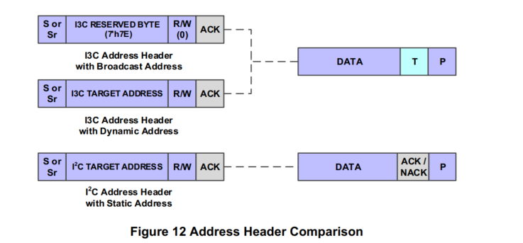

### I3C目标的角色

1. I3C目标从机是由I3C设备承担、对外展现的一类功能角色；这类硬件可以是仅对外暴露单个目标端点的独立物理器件；也可以是复合型设备，依靠共用外设硬件逻辑生成多个虚拟目标从机。以上两种情形下，总线之上每一个目标端点（包含虚拟目标）均可被分配独立唯一的动态地址；主控制器能够单独对其发起总线数据传输寻址。
2. I3C目标从机无需感知自身挂载在传统I2C总线还是I3C总线
3. 倘若设备带有I2C静态固定地址，在被分配动态地址之前，它可以凭借该静态地址作为一台I2C设备参与总线通信。一旦动态地址分配完成，除非收到复位指令，该设备必须只以I3C目标从机模式工作
4. 具备I3C能力的从机，在动态地址分配完毕之前，可以充当I2C设备，但该从机必须对地址为7'h7E的起始寻址帧作出ACK应答（唯一例外：该从机选择在当前总线环境下时始终仅作为纯I2C设备运行，此种情况下它会保持开启50ns尖峰滤波器）

**接收动态地址之前**

能够识别起始信号 START 以及广播地址 `7'h7E` 的目标从机，有可能接收到任意一类公共命令码（CCC），并不只会收到 ENTDAA（参阅 4.3.7.3.4），设备需要遵守下述行为规范：

- 从机必须正确处理所有强制广播类公共命令码，包含 ENTDAA、RSTDAA（4.3.7.3.3）、ENEC、DISEC（4.3.7.3.1）。

合规处理示例：

1. RSTDAA（重置动态地址）此时不会产生任何效果，设备尚且还未被分配动态地址；
2. 如果该从机在 I3C 总线上依靠 SETAASA、SETDASA 完成动态地址分配，则 ENTDAA 命令为可选支持；
3. 倘若从机永远不会发起主控角色申请，便可忽略用于关闭主控角色请求的 DISEC 命令。

- 从机必须识别 ENTHDR0～ENTHDR7 系列高速模式入口命令，随后等待高速模式退出序列；
- 当自身静态地址匹配时，从机可选择解析并执行 SETDASA 公共命令码（4.3.7.3.10）；
- 从机可选择解析并执行 SETAASA 公共命令码（4.3.7.3.21）；
- 从机需要忽略所有**定向型 CCC 命令**，但必须能够识别定向命令帧的结束标志：即携带 `7'h7E` 的重复起始信号或是停止信号 STOP；
- 在动态地址尚未分配前，对于非强制、条件触发类广播 CCC，从机可以选择支持或是直接忽略。

即便分配动态地址之后该设备能够响应这些命令，上电初期依旧拥有选择权。举个例子：芯片可以仅在没有动态地址时开启测试模式。

- I3C 从机只需忽略仅由地址错误引发的 TE0 类型故障（详见表 43）。

**地址头匹配**

I3C 目标从机需要遵守下述工作规则：

1. 在起始信号 START 或者重复起始信号 Repeated‑START 之后，无论总线速率为本规范 4.3.1 章节规定的哪一档，一旦已经分配动态地址，I3C‑从机就会比对寻址地址，判断是否为 I3C 广播地址 `7'h7E` 或是自身的动态地址。

   如果该从机支持组地址功能（参见 4.3.4.4），还需要比对所有分配给自己的组地址。

   只要任意一项地址匹配成功，从机就将本条报文判定为 I3C‑Basic 单速率 (SDR) 报文。

2. 当报文寻址本机动态地址时，从机可以选择应答 ACK，或是被动非应答 NACK 地址头字节：

- A. 如果从机对地址头发出 ACK 应答，则必须遵照本节全部规范处理这条 I3C‑Basic SDR 报文。
- B. 如果从机执行 NACK（SDA 不拉低应答位），则忽略后续所有比特，一直等待下一个重复起始信号或是停止信号 STOP。

1. 报文寻址本机某一组地址、并且为写事务（读写位 RnW=0）时，从机可对地址头进行 ACK 或者被动 NACK：

- A. 若发出 ACK，则处理该报文，处理方式等同于向自身动态地址发起的 I3C‑Basic‑SDR 写事务。

1. 报文寻址 I3C 广播地址 `7'h7E` 且为写事务（RnW=0）时，从机至少需要解析处理报文的首个数据字节（报文携带数据的前提下）：

- A. 当 0x7E 广播报文附带 1 字节数据，该报文即为一条公共命令码 CCC，详细规则见 4.3.7 章节。

- B. I3C‑Basic 从机需要处理所有适用的强制类 CCC 命令（4.3.7.3）。命令分为永久强制、条件强制两类，参考表 16。

  

  针对强制 CCC：即便从机（或其内部系统）正在处理先前报文、暂时无法应答其余指令，也必须随时准备响应发送至自身动态地址的定向 CCC，例如读取设备状态命令 GETSTATUS（4.3.7.3.15）。详见 4.3.8.2.5。

- C. 当 CCC 命令切换 I3C‑Basic 总线工作模式，从机二选一执行：

  

  ① 新模式为动态地址分配模式（4.3.4），该模式为全部 I3C‑Basic 从机的硬性要求；本机尚未获取动态地址则参与地址分配；已经拥有动态地址，则等待代表退出该模式的 STOP 信号。

  

  ② 新模式为高速 HDR 模式；硬件支持高速模式便可切入 HDR 工作（6.1.4.1）；不支持则开启高速退出序列检测器（4.3.10.2、4.3.10.2.1），等待总线退出高速模式。

1. 如果寻址地址既不是广播地址 `7'h7E`，也不是本机已分配的任意地址（动态地址、组地址），I3C‑Basic 从机只需要等待重复起始信号或者 STOP 信号。

   

   设备可以按需监测总线上传输的比特电平，但唯一强制义务便是等待起始或停止时序。

> 注释：
>
> 重复起始信号、停止信号定义位于 2.3.2 以及 4.3.11.2，时序行为和 I2C 相近；但 I3C‑Basic 的时序参数并不等同于传统 I2C

### I3C基本目标作为具有静态地址的I2C目标的角色

I3C基本目标能够作为标准的I2C目标，只要它们具有I2C静态地址

有两种情况：

1. 它们在一个遗留I2C总线上，因此所有消息都来自一个遗留I2C控制器
2. 它们在一个I3C基础总线上，但I3C基本控制器没有为它们分配动态地址，因此它们继续作为I2C目标操作；与其I2C静态地址之间的消息使用I2C协议

所有符合要求的I3C基本目标有两个严格要求：

1. 一个I3C基本目标应识别所有必须的广播CCC，并对每个CCC采取适当的行动，即使该目标尚未接收到动态地址。这尤其包括ENTHDRn CCC
2. 一个I3C基本目标应识别HDR退出模式

### 复合设备与虚拟目标

1. 虚拟目标由一个I3C基本设备呈现，该设备同时在I3C基本总线上呈现其他虚拟目标，并且必须管理所有这些虚拟目标的通信。在这种情况下，虚拟目标可以被视为这种复合I3C基本设备的一个功能，该功能同时持有多个活动目标角色。I3C基本设备应为每个虚拟目标维护单独的配置，包括分配的动态地址。

2. 在动态地址分配阶段，共用外设逻辑负责处理ENTDAA（进入动态地址分配）流程，完成与I3C-basic主控制器、总线其余I3C-basic从设备之间的交互工作。相关工作包含：地址仲裁管控、输出48bit设备预置ID，同时保障所有处于激活状态的虚拟从机均可获取动态地址。共用外设逻辑还会在总线初始化阶段或是需要时发起hot-join请求

   > [!NOTE]
   >
   > 一个呈现多个虚拟目标的设备可能还支持SETDASA/SETAASA CCC，而不是ENTDAA CCC。如果是这样，则每个虚拟目标必须具有唯一的静态地址 。

### I3C基本地址头

I3C-basic的地址帧头紧随起始信号（START）或者重复起始信号（repeated start）之后，帧格式与I2C一致：7bit地址 + 1bitR/W + 1bitAck/Nack

1. 紧随START后的地址帧头为可仲裁地址帧头

2. I3C-basic从机可以借助可仲裁地址帧头，向I3C-basic主控制器发送以下三类请求：

   - 带内中断：该机制等效于通过电平跳变唤醒主控制器。发起带内中断时，从机发送自身动态地址，并且读写位置1
   - 控制器角色申请：只有BCR标记为主机能力的I3C设备，才允许发起该请求。次级控制器可通过该请求，向当前活跃主机抢占总线控制权；初始主机在让出控制权之后，也能够依靠该请求重新夺回主机身份。主机角色申请报文携带设备动态地址，读写位R/W置0
   - hot-join request：仅当I3C总线已经正常运行、从机设备上电就绪之后，从机才可发起hot-join,请求使用专用预留地址7‘h02

   I3C-basic从机仅允许在下面两种总线状态下，向主机发起上述三类请求：

   1. 总线处于空闲状态之后，检测到START信号（重复起始信号除外），从机遵循I3C地址仲裁规则，在START之后发送自身动态地址或者热加入地址7'h02

   2. 总线处于总线可用状态，从机可以通过拉低SDA引脚主动发出START信号，完整时序流程：

      - A：从机拉低SDA：主机需要在t_CAS时限之内将SCL时钟线拉低
      - B：主机同步拉低SDA，和从机的低电平信号产生时间重叠
      - C：主机拉低SCL之后，从机切换至开漏模式管控SDA,可拉低电平或者释放为高电平
      - D：之后从机即可按照第一种工况，正常发送地址报文

      ### I3C基本地址仲裁

      在启动（但不是重复启动）后，地址头将受到仲裁，这意味着控制器和一个或多个目标可能会尝试使用SDA将地址驱动到总线上。这种地址头被定义为可仲裁地址头

      1. 如果当前要输出的位是0，则设备应在SCL的下降沿后驱动SDA低，并保持低电平直到下一个SCL的下降沿
      2. 如果当前要传输的位是1，则设备不应驱动SDA，而应在SCL的下降沿将SDA置于高阻抗状态
         - 此外，设备应该SCL的上升沿监视SDA，以确定是否有其他设备将SDA驱动为低。如果其他设备将SDA驱动为低，则该设备已失去了仲裁，并且不应进一步参与次地址头。。即，该设备不应再传输任何位，但可以等待将来的开始（不能是重复开始）

      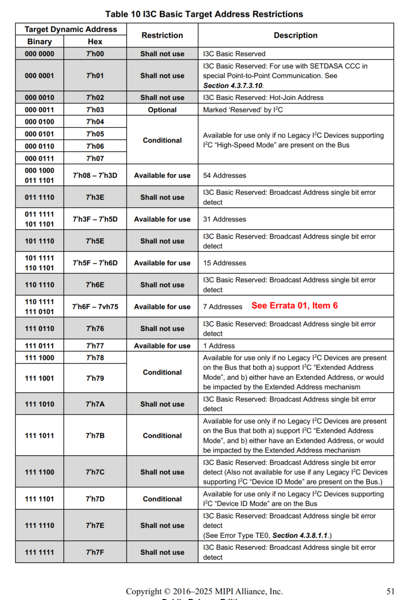

      ### I3C基本SDR数据字

      在I3C基本SDR中，数据字仅在长度上和I2C匹配，均为9位。I3C基本SDR数据字与I2C在三方面存在差异

      1. 从地址确认到SDR控制器写入数据的交接：在执行SDR写入时，从目标的地址头确认到控制器的第一数据位的交接在I3C basic中是不同的。I2C是开漏，因此ACK低电平与第一位的重叠是无害的，相反，I3C基础是push-pull，因此该交接是有规范的
      2. 作为就校验的SDR控制器写入数据的第9位：在I2C中，由控制器写入的第9数据位是由目标发出的确认。相比之下，在I3C basic中，由控制器写入的第9bit是前八个数据位的奇偶校验。因此，在I3C basic中，目标不得驱动由控制器在SDR中写入的数据的SDA线。在SDR术语中，写入数据的第9位成为T位（“过渡”）
      3. SDR目标返回（读取）数据的第9位作为数据结束：在I2C中，从目标到控制器的第9位数据由控制器确认。相比之下，在I3C basic中，此位允许目标结束读取，并允许控制器中止读取。在SDR术语中，读取数据的第9位成为T位（过渡）

      > [!NOTE]
      >
      > 目标应具备一个SDA读取检测器，以确定SCL时钟是否未发生变化超过150微秒，从而能够通过将SDA切换到高阻抗并等待重复开始或停止来放弃读取

      ### 从地址确认到SDR控制器写入数据的过渡

      所有地址帧头（无论是否经过总线仲裁）的末尾，都由一个或多个被寻址的从机target，通过开漏模式操控SDA引脚，发出应答ACK或者非应答NACK

      - 当地址为7'h7E（广播地址）：代表总线上全部I3C basic从机做出应答ACK
      - 当为单个从机地址：由被寻址的目标从机返回ACK/NACK；若总线不存在该地址的从机，则返回NACK

      当地址帧头收到应答ACK，且本次传输为主机发起的SDR高速写入报文时：传输首个数据位前，SDA信号线需要从开漏模式切换至push-pull输出模式

      为保障模式切换过程硬件安全，I3C-basic标准速率SDR协议规定了信号线控制权的交接流程，流程总结如下：

      **从机应答阶段**：SCL 时钟处于低电平时，I3C 基础从机强制拉低 SDA 电平；该阶段 SDA 工作在开漏模式、SCL 保持低电平。

      **SCL 时钟上升沿后从机释放总线**：从机检测到 SCL 上升沿，立刻将 SDA 设置为**高阻态 (High‑Z)**；从机遵照标准推挽时序释放 SDA，时钟上升沿到来即刻释放信号线。

      **主机接管拉低 SDA（短时电平重叠保护）**：SCL 上升沿过后，I3C 主机主动拉低 SDA 引脚。

      该操作会造成**主机、从机短暂同时拉低 SDA**，该电平重叠属于安全状态，不会引发总线冲突；

      SCL 高电平的持续时长，最低可以取文档 4.3.11.2 章节规定的最小时长 `tDIG_H`。

      **SCL 下降沿，主机正式推挽输出数据**：当 SCL 出现下降沿，主机切换为推挽驱动模式，在 SDA 线上输出第一位传输数据（时序参考图 76）。

      若地址帧头收到从机的非应答 NACK，主机二选一执行后续动作：

      1. 发起**重复起始信号 (Repeated START)**，继续本次总线事务；
      2. 发送停止位 (STOP)，释放 I3C 总线

### 3.2.2 I3C Target Device

1. In addition to responding to I3C Commands,an I3C Target Device always supports I3C **SDR Mode**
2. An I3C Target Device does not generate the bus clock,and always

